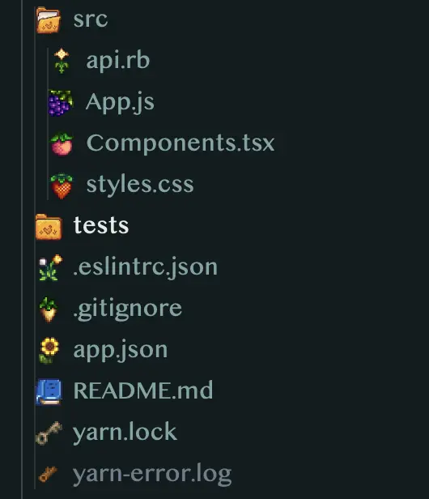
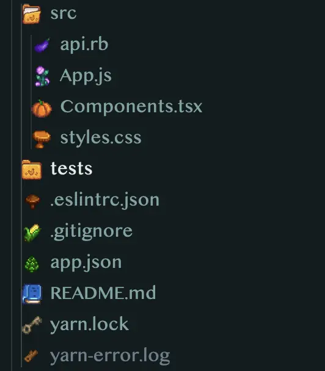
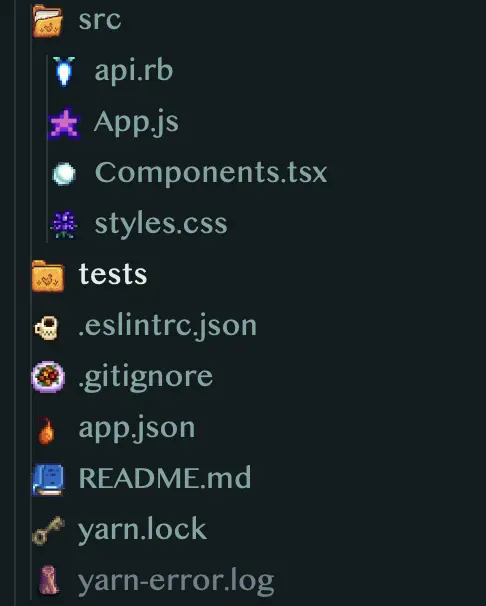

# Stardew Icon Theme for Zed

A Stardew Valley themed file icon theme for [Zed](https://zed.dev).
Covers common front-end web development file types, with three seasonal variants:

- **Stardew Icons: Summer**
- **Stardew Icons: Autumn**
- **Stardew Icons: Winter**

## Summer



### Autumn



### Winter



## Installation

1. Open Zed and run `zed: extensions` from the command palette.
2. Search for **Stardew Icons Theme** and install it.
3. Run `icon theme selector: toggle` and pick a variant.

Or set it in `settings.json`:

```json
{
  "icon_theme": "Stardew Icons: Autumn"
}
```

## Credits

Inspired by [vscode-stardew-icon-theme](https://github.com/klyap/vscode-stardew-icon-theme) by [klyap](https://github.com/klyap), the original VS Code version of this icon pack.

Icons from the [Stardew Valley Wiki](https://stardewvalleywiki.com/Stardew_Valley_Wiki).
Stardew Valley is created by ConcernedApe; this project is unaffiliated.

## License

MIT
